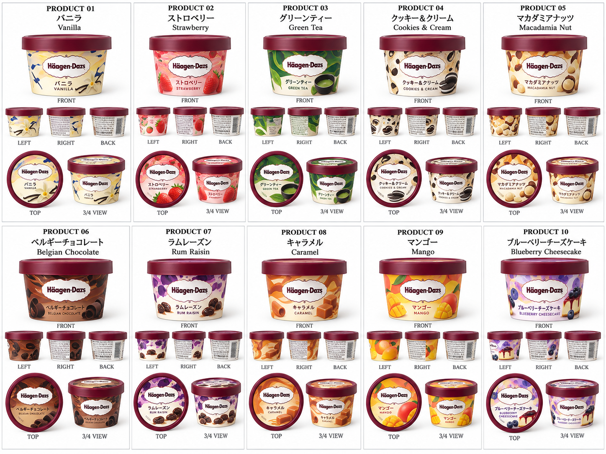

# Fuji Konbini

**A small store, a pause in your day.**

An interactive 3D convenience store at the foot of Mount Fuji. Walk inside, browse the shelves, and talk with a virtual clerk about what you feel like having today.

This is a personal design and development project in progress, combining a modeled environment, a searchable product catalog, and an experimental conversational shopping experience.

[简体中文](README.md) · **English** · [Product orthographic gallery](design/product-orthographics/README.md) · [Architecture](docs/architecture.md) · [Current status](docs/project-status.md)

## Product design references

Explore **30 original product orthographic / multiview sheets** created with GPT and supplied during the modeling process: packaging studies for chilled food, ice cream, snacks, sweets, pantry goods, daily essentials and checkout products.

[**Browse the original reference gallery →**](design/product-orthographics/README.md)



The reference gallery preserves earlier design ideas as well as references used for modeling. The actual modeled inventory is documented separately in the catalog.

## What you can explore

- A 3D street and convenience store, with weather and time-of-day controls.
- Third-person exploration with two customer styles, plus a first-person view.
- A searchable catalog of **603 entries**: 600 modeled product entries and 3 coffee services.
- Product cards, individual and pairing add-to-basket actions, and in-store wayfinding.
- A cream-and-green clerk panel with English controls and Chinese, Japanese and English conversation support. Japanese signage and packaging remain part of the scene.
- A server-side model connection. The prepared configuration uses Bailian in direct-response mode; users supply their own key locally.


## Run locally

Install Node.js 22 or later; this snapshot was checked with Node.js 24. The server uses Node built-ins and the browser libraries are included, so no dependency installation is needed.

```sh
npm start
```

Open **http://127.0.0.1:8011/**. Without API credentials, you can explore and browse; live model conversation requires the setup below. If another copy is already running on port 8011, stop it or choose a different `PORT` environment variable.

### Enable the clerk

Copy `server/.env.example` to `server/.env.bailian`, fill in `DASHSCOPE_API_KEY` locally, and restart the server. The example selects `qwen3.6-plus` and `CLERK_REPLY_MODE=direct`. Model availability, quotas and billing depend on the provider account; this repository does not provision an account or free credits. No automatic fallback model is configured.

The browser sends requests to `/api/clerk`; the backend supplies credentials to the provider. Only `web/` is served as static content. See [server setup](server/README.md).

### Verify the snapshot

```sh
npm run check
npm test
```

Tests use mocked provider responses, not paid model requests. They cover both current code and retained structured-mode experiments; passing them does not establish real-model response quality.

## Repository structure

```text
web/                  Browser application
  src/                Scene, navigation, characters and clerk UI
  models/             GLB assets loaded by the current scene
  assets/             Referenced product and clerk images
  data/               Catalog and separate project information
  vendor/             Included Three.js libraries
  tests/              Catalog and local-engine checks
server/               Local HTTP server, model adapters and tests
  skills/             Prompt material for retained structured experiments
  .env.example        Empty credential template
scripts/              Offline checks
design/               Original product orthographic reference gallery
docs/                 Project notes, screenshots and update guide
```

## Project boundaries

This is a portfolio prototype, not an official 7-Eleven service or a real checkout. Prices and food information include project-designed values and similar-product references; they are not verified labels for real purchases. Direct model replies can still invent attributes or disagree with product cards. The character models are simplified prototypes, not exact reproductions of the approved concept artwork.

In this review snapshot, 285 catalog entries use approved supplied images; the remaining 318 do not yet have the final approved label treatment. Existing render previews and service illustrations are not counted as finished labels.

Editable Blender source files and historical modeling exports remain in the local modeling archive. The repository contains the runtime exports needed by the website. Uploading this repository does not deploy a public website.

## Credits

Built using Three.js, Blender and AI-assisted design/development workflows. Third-party marks and packaging remain the property of their respective owners. See [asset and dependency notes](docs/asset-notes.md). No blanket license is granted for the collected artwork or brand assets.
