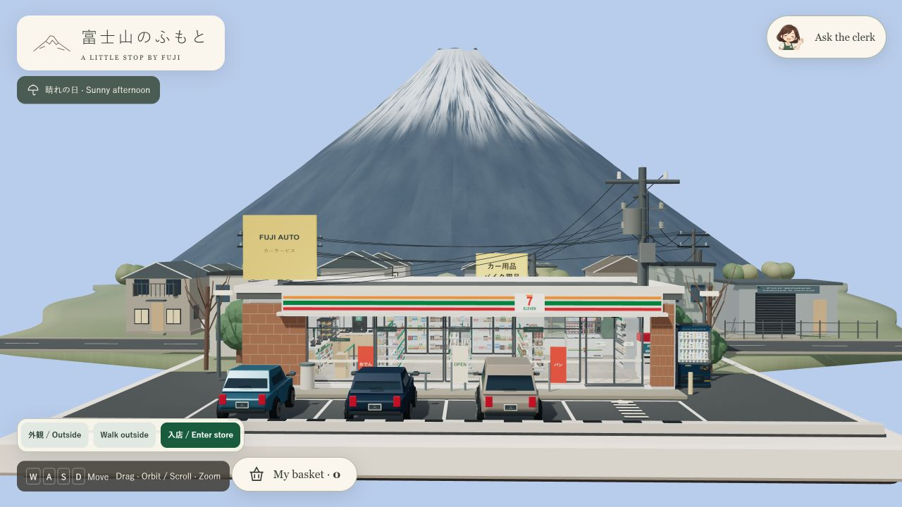
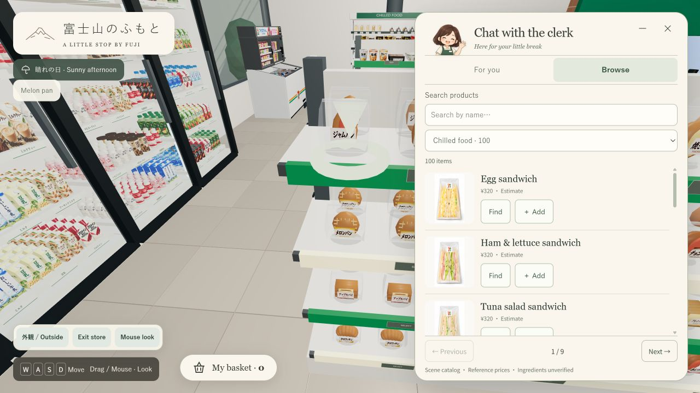
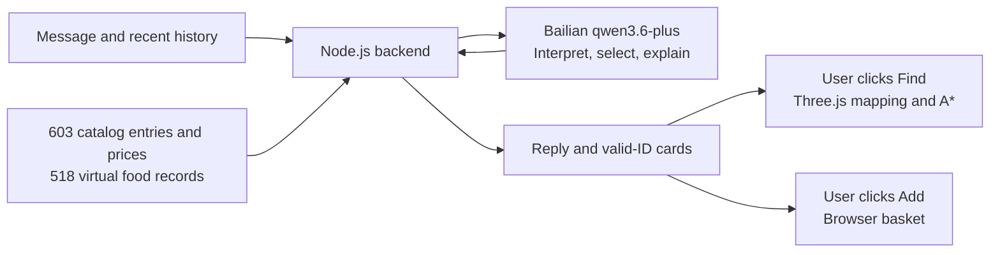

# Fuji Konbini

**A conversational product-discovery prototype connecting AI recommendations with 3D shopping interaction.**

Fuji Konbini connects natural-language consultation, **603 catalog entries and 518 virtual food records** to a Three.js store: ask, inspect a product, find its shelf and add it to a basket. It explores how generative AI can support a concrete selection task.

[简体中文](README.md) · **English**

[Try locally](#try-locally) · [Experience](#core-experience) · [Architecture audit](docs/ai-pm/architecture-audit.md) · [Design references](design/product-orthographics/README.md)



*A locally runnable AI product prototype. Screenshot shows the prototype scene. A public demo is not deployed.*

**603 catalog entries with 3D mappings** · **518 virtual food records** · **Chinese / Japanese / English conversation**

## Product Problem / Product Goal

Visitors often start with a situation or preference—breakfast before departure, a small bite or a limited budget—rather than a product category. Text advice still leaves them to identify the item, locate it and decide what to do next.

The prototype serves **situational selection and store exploration** through two connected paths: search/browse for visitors with a clear target, and clerk conversation for visitors who need suggestions. Product cards, Find and Basket provide the next actions in both paths.

**Product hypothesis:** connecting advice to inspectable products and spatial actions can reduce the handoffs between understanding a suggestion, finding it and choosing it. The interaction is implemented; efficiency gains have not been validated through formal user research or quantitative experiments.

**My contribution:** experience and scope definition, product-data organization and scene mapping, interface iteration, and an architecture audit to clarify AI boundaries and priorities. GPT / Codex supported artwork and implementation. This is a personal product-design and development project.

## Core Experience

1. **Ask or browse.** Talk to a 2D clerk, or search and filter the catalog in Browse.
2. **Inspect a suggestion.** Valid recommended IDs become up to three product cards with catalog names, available artwork and actions.
3. **Find it in the store.** Click **Find** to mark the product and follow an **A\* route** through the Three.js scene.
4. **Make the choice.** Use **Add** or **Add pairing**, adjust quantities in Basket and export a virtual receipt.



Explore the store in first person and talk to the 3D cashier. The catalog includes 600 modeled product entries and three coffee services. Clerk controls are English, with Japanese signage and some Chinese scene controls. No payments or real orders.

## How It Works



The **direct architecture** sends the compact full catalog, recent history and question in one model request. The LLM writes and selects IDs; code removes invalid/duplicate card IDs and maps products to the scene. User clicks trigger actions.

## AI Product Design / Mechanisms and Decisions

The current design uses the LLM to generate suggestions and application code to connect products with actions, with explicit boundaries around data, context and execution.

| Mechanism | Current implementation and trade-off |
| --- | --- |
| **Grounding and identity** | Full-catalog input and shared IDs connect up to three cards to catalog names, artwork and 3D objects. Invalid/duplicate IDs are removed; prose facts are not thereby verified. |
| **Data provenance** | Scene identities and locations are distinct from virtual food labels. Nutrition, portions and ingredients include project settings; prices are references or estimates, not verified package facts. |
| **Short-term context** | The last **eight messages** accompany the latest question. Browser-memory history resets on refresh; earlier requirements can leave the window. Persistent requirements are planned. |
| **Language versus deterministic execution** | The LLM interprets, selects and explains. Code handles transport, mapping, navigation and Basket. Budget/nutrition arithmetic and constraint compliance remain with the model. |
| **Human-in-the-loop** | Visitors inspect cards and trigger Find / Add themselves. Suggestions do not automatically become orders, and failures do not silently substitute products. |
| **Failure feedback and observability** | Request IDs, timing, model metadata and error diagnostics support investigation and retry feedback. They are not an automated recommendation-quality evaluation system. |

The response contract separates `message` from `productIds`. Evaluation must likewise distinguish **request success, constraint satisfaction, prose-to-card consistency and task completion**. A successful API response alone does not establish a correct recommendation.

## Current Limitations

Direct mode has limited memory, no active deterministic ranking and no comprehensive budget, nutrition, allergy or prose-to-card validation. Requests include the full catalog. SSE provides waiting updates; model text arrives as a completed response.

## Next Iteration / Roadmap

1. **Requirement management:** retain goals, budgets, exclusions and update sources; distinguish additions from corrections and test multi-turn updates.
2. **Recommendation trust:** audit virtual food data, include missing input fields, and add deterministic arithmetic and explainable filtering/ranking. Check numbers, constraints and card consistency.
3. **Evaluation and interaction:** build multilingual task sets, compare smaller inputs and waiting feedback, then measure quality, task completion, errors and latency with users.

These are planned capabilities, not claims about the current implementation.

<details>
<summary><strong>Evaluation design: what the next iteration should establish</strong></summary>

This proposed framework has no formal results or achieved KPIs yet. Offline fixtures, live-model evaluation and usability sessions will be reported separately.

| Dimension | Proposed checks |
| --- | --- |
| Task completion | Can visitors select a product, reach its shelf and add it to Basket? |
| Constraint compliance | Are budgets, exclusions and explicit requirements satisfied and retained across turns? |
| Factual/interface consistency | Do product names, amounts and nutrition values match the catalog and displayed cards? |
| Interaction reliability | Time to actionable cards, error types, and Find failures or interruptions |
| Language consistency | Equivalent Chinese / Japanese / English tasks: interpretation, product mapping and completion |

</details>

## Tech Stack

**Three.js / JavaScript**: scene and A* navigation · **Node.js**: backend and model adapter · **Bailian `qwen3.6-plus`**: direct replies · **JSON / GLB / Blender**: data and modeling.

## Try Locally

With Node.js 22+, run at the repository root:

```sh
npm start
```

Open [the local store](http://127.0.0.1:8011/). Browsing needs no model key; conversation requires your own server-side credentials. See [setup](server/README.md).

## Evidence and Design Process

- **[Full architecture audit](docs/ai-pm/architecture-audit.md)** — Chinese report with code links, request tracing and offline evidence.
- [30 product orthographic / multiview sheets](design/product-orthographics/README.md) — design-process references.
- [Verification scope](docs/verification.md) · [Assets and dependencies](docs/asset-notes.md) · [Changelog](CHANGELOG.en.md)

Personal portfolio prototype; no official affiliation with 7-Eleven or featured brands.
