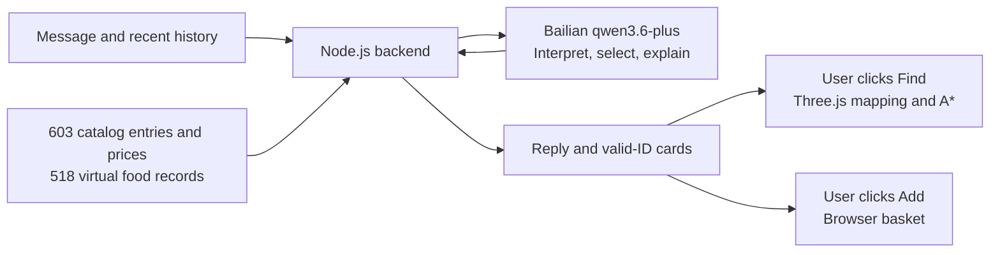

# Fuji Konbini

**Turn “what should I have today?” into a 3D shopping journey you can explore.**

[简体中文](README.md) · **English**

[Try locally](#try-locally) · [Experience](#core-experience) · [Architecture audit](docs/ai-pm/architecture-audit.md) · [Design references](design/product-orthographics/README.md)


*A locally runnable AI product prototype. Screenshot shows the prototype scene. A public demo is not deployed.*

**603 catalog entries with 3D mappings** · **518 virtual food records** · **Chinese / Japanese / English conversation**

## Product Problem / Why I Built It

Visitors may know they want something warm or a small bite, without knowing which product to choose. A text recommendation still leaves them to find it.

My product question: **can conversational advice become a visible product and a clear next action?** Mount Fuji provides a setting for breakfast, an afternoon pause or shelter from rain.

I defined the experience, organized product information and guided feature decisions, using GPT / Codex for artwork and implementation support. This is a working personal prototype; formal user research and measured usability outcomes are future work.

## Core Experience

1. **Ask or browse.** Talk to a 2D clerk, or search and filter the catalog in Browse.
2. **Inspect a suggestion.** Valid recommended IDs become up to three product cards with catalog names, available artwork and actions.
3. **Find it in the store.** Click **Find** to mark the product and follow an **A* route** through the Three.js scene.
4. **Make the choice.** Use **Add** or **Add pairing**, adjust quantities in Basket and export a virtual receipt.


Explore in first or third person with two customer styles and a 3D cashier. The catalog includes 600 modeled product entries and three coffee services. Clerk controls are English, with Japanese signage and some Chinese scene controls. No payments or real orders.

## How It Works



The **direct architecture** sends the compact full catalog, recent history and question in one model request. The LLM writes and selects IDs; code removes invalid/duplicate card IDs and maps products to the scene. User clicks trigger actions.

## AI Product Decisions

| Decision | Implementation and trade-off |
| --- | --- |
| **Catalog grounding** | Shared IDs connect cards and 3D objects. Card identity is checked; prose facts need stronger validation. |
| **Explicit data provenance** | Food data is project-designed; prices are analog references or estimates, not verified package facts. |
| **Language/action boundary** | The LLM interprets and recommends; code maps IDs and executes navigation and Basket. Arithmetic remains with the model. |
| **Short context** | Last **eight messages**, cleared on refresh. Persistent requirements are a next step. |
| **Human-in-the-loop** | Visitors choose Find / Add. Suggestions do not become purchases automatically; failed requests do not substitute products. |

## Current Limitations

Direct mode has limited memory, no active deterministic ranking and no comprehensive budget, nutrition, allergy or prose-to-card validation. Requests include the full catalog. SSE provides waiting updates; model text arrives as a completed response.

## Next Iteration / Roadmap

1. **Requirements:** retain goals, budgets and exclusions; test corrections and swaps across turns.
2. **Verification:** audit food data; add deterministic arithmetic and explainable filtering/ranking. Evaluate constraint and card consistency.
3. **Evaluation:** build multilingual task sets, test smaller inputs and waiting feedback, then measure completion, errors and latency with users.

These are planned capabilities, not claims about the current implementation.

## Tech Stack

**Three.js / JavaScript**: scene and A* navigation · **Node.js**: backend and model adapter · **Bailian `qwen3.6-plus`**: direct replies · **JSON / GLB / Blender**: data and modeling.

## Try Locally

With Node.js 22+, run at the repository root:

```sh
npm start
```

Open [the local store](http://127.0.0.1:8011/). Browsing needs no model key; conversation requires your own server-side credentials. See [setup](server/README.md).

## Evidence and Design Process

- **[Full architecture audit](docs/ai-pm/architecture-audit.md)** — Chinese report with code links, request tracing and offline evidence.
- [30 product orthographic / multiview sheets](design/product-orthographics/README.md) — design-process references.
- [Verification scope](docs/verification.md) · [Assets and dependencies](docs/asset-notes.md) · [Changelog](CHANGELOG.en.md)

Personal portfolio prototype; no official affiliation with 7-Eleven or featured brands.
