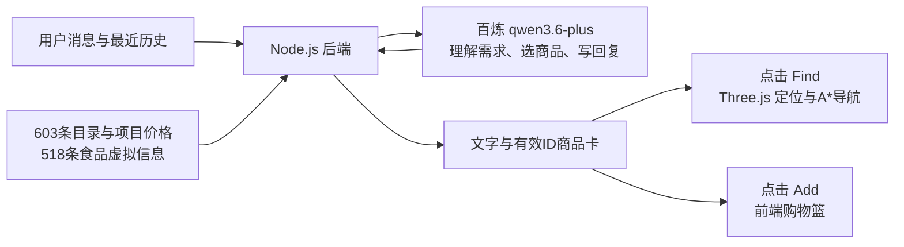

# Fuji Konbini｜富士山便利店

**面向便利店场景的对话式商品发现与 3D 购物交互原型。**

通过 AI 店员理解自然语言需求，将 **603 个商品目录条目、518 个食品虚拟信息记录与 Three.js 场景**连接为“咨询 → 查看商品 → 定位货架 → 加入购物篮”的体验，探索生成式 AI 如何支持具体的选品任务。

**简体中文** · [English](README.en.md)

[本地体验](#本地体验) · [核心体验](#核心用户体验) · [架构审查](docs/ai-pm/architecture-audit.md) · [产品正交图](design/product-orthographics/README.md)


*可本地运行的 AI 产品原型。截图展示原型场景；在线 Demo 尚未部署。*

| 产品范围 | 当前实现 |
| --- | --- |
| 商品与空间 | **603 个目录条目**及其 3D 场景映射，含 600 个建模商品条目和 3 项咖啡服务 |
| 食品信息 | **518 个食品虚拟信息记录**，包含项目份量、营养、配料等数据 |
| 核心闭环 | 对话／浏览 → 商品卡 → Find 定位与 A* 导航 → Add／Basket |
| 语言 | 中／日／英对话；英文店员控件，日文招牌与包装，部分外围界面仍为中文 |

## Product Problem / 产品问题与目标

便利店商品丰富，但用户通常从情境和偏好出发，例如“清晨出发前想吃点东西”“预算有限，想选一份搭配”。商品分类与用户表达之间存在转换成本；单纯的文本推荐又把商品识别、位置查找和操作选择留给用户完成。

项目以**情境选品与店内探索**为目标任务，设计两条互通路径：让有明确目标的用户搜索、浏览商品，让需求尚不明确的用户先与店员交谈，再用商品卡、Find 和购物篮完成选择。富士山下的旅行场景提供了清晨、午后、雨天等体验背景。

**产品假设**：将自然语言咨询连接到可检查的商品卡与空间行动，可以降低“理解建议 → 找到商品 → 作出选择”之间的操作断点。当前已实现这一交互流程，尚未通过正式用户研究或量化实验验证效率提升。

**我的工作**：定义体验流程与功能范围，组织商品资料及场景映射，推进界面和交互迭代，并通过架构审查明确 AI 能力边界与下一步优先级。GPT／Codex 用于参考图、工程实现和迭代辅助；项目为个人产品设计与开发作品。

## 核心用户体验

1. **说出需求**：与 2D 店员聊天，获得自然语言建议；也可直接进入 Browse，搜索或按分类挑选商品。
2. **看见商品**：推荐中的有效商品 ID 映射为最多三张卡片，显示目录名称、已有商品图和操作入口。
3. **走到货架前**：点击 **Find** 标记对应商品，沿 Three.js 场景中的 **A\* 路径**前往可站立位置。
4. **自己作选择**：点击单品 **Add** 或 **Add pairing**，在 Basket 查看数量、移除商品并导出虚拟清单。


顾客支持第三人称／第一人称切换和两种简化造型，收银台有 3D 店员。购物篮用于体验选择过程，没有支付和真实订单。

## How It Works



当前使用 **direct architecture**：每次将全量精简目录、最近聊天历史和当前问题发送给模型。LLM 返回文字与商品 ID；Node 后端去除无效／重复 ID，前端再映射到商品与场景节点。Find 和加购由用户点击前端函数触发。

## AI Product Design / AI 产品机制与决策

当前采用“LLM 生成建议，应用代码连接商品与动作”的产品架构。重点是让对话结果可被用户查看和操作，同时明确数据、记忆与执行的边界。

| 产品机制 | 当前实现与产品取舍 |
| --- | --- |
| **商品依据与身份映射（Grounding）** | 模型接收完整精简目录并返回商品 ID。后端移除无效／重复 ID，前端把最多三张卡片映射到已有名称、图片和 3D 节点。保证卡片身份可对应，不等于正文事实已核验。 |
| **数据分层与来源意识** | 商品身份、位置与图片属于场景数据；食品份量、营养和配料含项目虚拟设定；价格为同类参考或估价。模型能够读取数值，但这些记录不作为实物标签或过敏安全认证。 |
| **短期上下文（Context）** | 最近 **8 条消息**与当前问题一同发送，支持短程追问。历史保存在前端内存、刷新清空；较早条件会退出窗口，持续需求状态列入下一步。 |
| **语言理解与确定性执行分工** | LLM 负责理解需求、选择商品和组织解释；普通代码负责通信、ID映射、寻路、加购与数量管理。当前预算／营养算术与条件遵循仍由模型处理。 |
| **用户保留行动权（Human-in-the-loop）** | Find／Add 由用户检查卡片后点击触发。模型提出建议，用户决定是否行动；推荐不会自动成为订单，失败不会静默替换成备用商品。 |
| **失败反馈与可观察性** | 请求具有编号、耗时、模型来源与错误诊断；失败时展示原因和重新填写入口。这些信息帮助区分连接、格式与推荐质量问题，尚未构成自动化质量评估系统。 |

模型输出约定为 `message` 与 `productIds` 两部分，将自然语言解释和界面商品映射分开。评估也需要分别检查：**接口是否成功、推荐是否符合条件、正文与卡片是否一致、用户能否完成任务**；接口返回成功本身不能代表推荐正确。

## Current Limitations

当前原型的重点是打通“对话 → 商品 → 空间行动”。direct 模式仍有三项主要边界：

- **上下文有限**：没有启用持久化结构需求记忆，较早的预算或排除条件可能离开历史窗口。
- **选品与事实核验有限**：当前没有代码执行的确定性推荐排序，也没有完整的营养、预算、过敏与正文／卡片一致性核验。
- **调用与等待体验待优化**：每次发送全量目录；页面有 SSE 等待心跳，当前模型上游完整返回后再显示正文。

## Next Iteration / Roadmap

| 优先级 | 计划 | 准备如何验证 |
| --- | --- | --- |
| P1 · 连续需求管理 | 显式保存目标、预算、排除项及更新来源，区分追加条件与明确改口 | 用多轮“补充／改口／换搭配”用例检查条件保留与更新 |
| P2 · 数据与推荐可信度 | 审核虚拟食品数据、补齐模型输入字段；加入确定性预算／营养计算与可解释筛选排序 | 对照目录逐条检查数值、约束满足情况及正文／卡片一致性 |
| P3 · 评估与交互优化 | 建立中日英任务集，比较输入缩减与等待反馈方案，再组织可用性测试 | 同时记录推荐质量、任务完成情况、错误类型和响应时间 |

以上为后续计划，尚未作为当前能力启用。

<details>
<summary><strong>评估设计：下一轮准备验证什么</strong></summary>

以下是待实施的评估框架，尚未采集正式结果或形成已达成 KPI。离线构造用例、真实模型评测与用户可用性测试将分别记录。

| 评估维度 | 拟检查的内容 |
| --- | --- |
| 任务完成 | 在固定任务中，用户能否选定商品、到达目标货架并完成加购 |
| 条件遵循 | 预算、排除项及其他明确条件是否逐条满足，多轮补充后是否保留 |
| 事实与界面一致性 | 回答中的商品、金额与营养数值是否有目录依据，商品名是否与卡片对应 |
| 交互效率与可靠性 | 从发问到可操作卡片的等待时间、错误类型、Find 失败与中断情况 |
| 多语言一致性 | 中／日／英等价任务中的条件理解、商品对应与任务完成情况 |

</details>

## Tech Stack

| 技术 | 用途 |
| --- | --- |
| Three.js / JavaScript | 3D 场景、人物、商品交互、A* 寻路 |
| Node.js | 同源 HTTP 服务、模型适配与诊断；密钥仅由后端使用 |
| 百炼 / Qwen | 当前配置为 `qwen3.6-plus`、`direct` 模式 |
| JSON / GLB / Blender | 商品与虚拟食品数据、场景导出、模型与材质工作流 |

## 本地体验

需要 Node.js 22+，在仓库根目录运行：

```sh
npm start
```

打开 [本地便利店](http://127.0.0.1:8011/)。场景和商品浏览可独立体验；模型对话需按 [运行说明](docs/README.zh-CN.md) 配置自己的服务端密钥。仓库上传不等于网站部署。

## 进一步了解

- **[完整架构审查](docs/ai-pm/architecture-audit.md)**：真实调用路径、代码与核心函数、记忆和数据边界、示例追踪及离线证据。
- [30 张产品正交／多视图参考](design/product-orthographics/README.md)：从包装参考到商品建模的设计过程。
- [验证记录](docs/verification.md) · [素材与依赖说明](docs/asset-notes.md) · [日常更新指南](docs/daily-updates.zh-CN.md)

个人作品集原型，与 7-Eleven 及相关品牌无官方关联。
