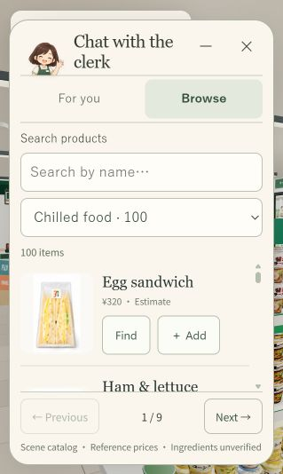
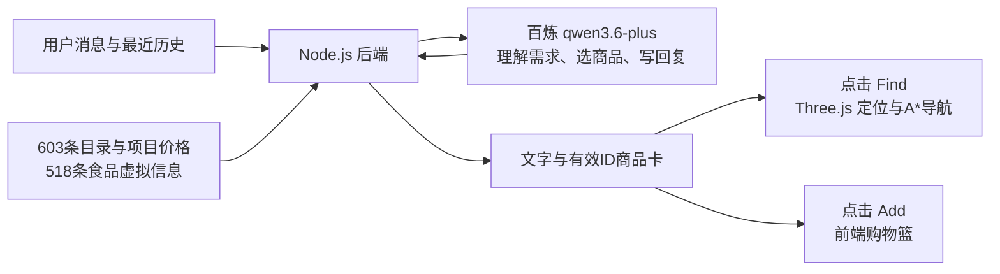

# Fuji Konbini｜富士山便利店

**把“今天想吃什么”，变成一次可以走到货架前的 3D 购物探索。**

**简体中文** · [English](README.en.md)

[本地体验](#本地体验) · [核心体验](#核心用户体验) · [架构审查](docs/ai-pm/architecture-audit.md) · [产品正交图](design/product-orthographics/README.md)


*可本地运行的 AI 产品原型。截图展示原型场景；在线 Demo 尚未部署。*

| 产品范围 | 当前实现 |
| --- | --- |
| 商品与空间 | **603 个目录条目**及其 3D 场景映射，含 600 个建模商品条目和 3 项咖啡服务 |
| 食品信息 | **518 个食品虚拟信息记录**，包含项目份量、营养、配料等数据 |
| 核心闭环 | 对话／浏览 → 商品卡 → Find 定位与 A* 导航 → Add／Basket |
| 语言 | 中／日／英对话；英文店员控件，日文招牌与包装，部分外围界面仍为中文 |

## Product Problem / Why I Built It

便利店选择很多，而需求往往只是一句模糊的“想吃点热的”“想垫垫肚子”。推荐如果停留在文字里，用户还需要自己理解商品、找到位置，再决定要不要选。

我想探索：**能否把自然语言建议接到可见的商品和可执行的空间行动上？** 富士山下的便利店提供了清晨出发、午后停留和雨天避雨的情境，让 AI 店员成为探索场景的入口。

这是个人产品设计与开发项目。我负责体验方向、商品资料组织、界面与功能取舍，并通过 GPT／Codex 辅助参考图、代码实现和迭代。当前完成了可交互原型；尚未进行正式用户研究或量化可用性实验，不将设计假设描述为已验证成效。

## 核心用户体验

1. **说出需求**：与 2D 店员聊天，获得自然语言建议；也可直接进入 Browse，搜索或按分类挑选商品。
2. **看见商品**：推荐中的有效商品 ID 映射为最多三张卡片，显示目录名称、已有商品图和操作入口。
3. **走到货架前**：点击 **Find** 标记对应商品，沿 Three.js 场景中的 **A* 路径**前往可站立位置。
4. **自己作选择**：点击单品 **Add** 或 **Add pairing**，在 Basket 查看数量、移除商品并导出虚拟清单。



顾客支持第三人称／第一人称切换和两种简化造型，收银台有 3D 店员。购物篮用于体验选择过程，没有支付和真实订单。

## How It Works



当前使用 **direct architecture**：每次将全量精简目录、最近聊天历史和当前问题发送给模型。LLM 返回文字与商品 ID；Node 后端去除无效／重复 ID，前端再映射到商品与场景节点。Find 和加购由用户点击前端函数触发。

## AI Product Decisions

| 产品选择 | 实现与取舍 |
| --- | --- |
| **让建议有具体落点（Grounding）** | 用真实目录 ID 连接卡片、图片与场景。卡片可对应店内商品，但正文事实仍需进一步核验。 |
| **区分项目数据与实物事实** | 营养、配料和份量含虚拟标签设定；价格为同类参考或估价。提供可演示的数据，不将其作为真实包装或过敏安全认证。 |
| **明确 LLM 与代码职责** | 模型负责理解、选品和表达；代码负责请求、ID映射、界面、导航与购物篮。当前预算和营养计算仍由模型自行处理。 |
| **短上下文先跑通体验** | 当前保留最近 **8 条消息**，刷新后清空；需求状态的持续保存列入下一步。 |
| **保留用户行动权（Human-in-the-loop）** | 用户查看建议后，自行点击 Find／Add。推荐不自动变成购买，失败也不悄悄换成备用商品。 |

## Current Limitations

当前原型的重点是打通“对话 → 商品 → 空间行动”。direct 模式仍有三项主要边界：

- **上下文有限**：没有启用持久化结构需求记忆，较早的预算或排除条件可能离开历史窗口。
- **选品与事实核验有限**：当前没有代码执行的确定性推荐排序，也没有完整的营养、预算、过敏与正文／卡片一致性核验。
- **调用与等待体验待优化**：每次发送全量目录；页面有 SSE 等待心跳，当前模型上游完整返回后再显示正文。

## Next Iteration / Roadmap

| 优先级 | 计划 | 准备如何验证 |
| --- | --- | --- |
| P1 · 可靠记住条件 | 显式保存目标、预算、排除项及其更新来源 | 用多轮“补充／改口／换搭配”用例检查条件保留 |
| P2 · 推荐可核验 | 审核食品数据，补齐输入字段；加入确定性预算／营养计算与可解释筛选排序 | 对照目录数值检查约束满足率和文字／卡片一致性 |
| P3 · 评估与体验 | 建立中日英任务集，验证输入缩减与等待反馈，再组织可用性测试 | 分开记录任务完成率、错误类型和响应时间 |

以上为后续计划，尚未作为当前能力启用。

## Tech Stack

| 技术 | 用途 |
| --- | --- |
| Three.js / JavaScript | 3D 场景、人物、商品交互、A* 寻路 |
| Node.js | 同源 HTTP 服务、模型适配与诊断；密钥仅由后端使用 |
| 百炼 / Qwen | 当前配置为 `qwen3.6-plus`、`direct` 模式 |
| JSON / GLB / Blender | 商品与虚拟食品数据、场景导出、模型与材质工作流 |

## 本地体验

需要 Node.js 22+，在仓库根目录运行：

```sh
npm start
```

打开 [本地便利店](http://127.0.0.1:8011/)。场景和商品浏览可独立体验；模型对话需按 [运行说明](docs/README.zh-CN.md) 配置自己的服务端密钥。仓库上传不等于网站部署。

## 进一步了解

- **[完整架构审查](docs/ai-pm/architecture-audit.md)**：真实调用路径、代码与核心函数、记忆和数据边界、示例追踪及离线证据。
- [30 张产品正交／多视图参考](design/product-orthographics/README.md)：从包装参考到商品建模的设计过程。
- [验证记录](docs/verification.md) · [素材与依赖说明](docs/asset-notes.md) · [日常更新指南](docs/daily-updates.zh-CN.md)

个人作品集原型，与 7-Eleven 及相关品牌无官方关联。
