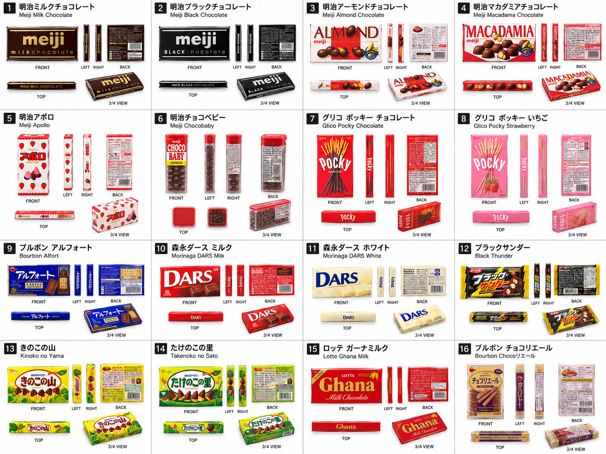
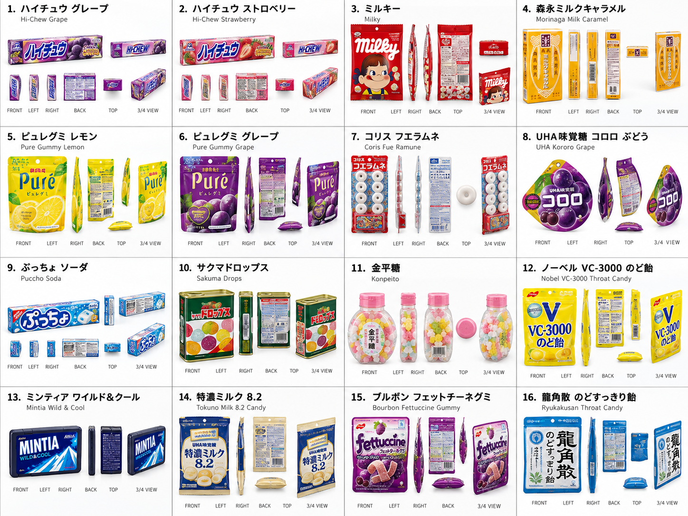
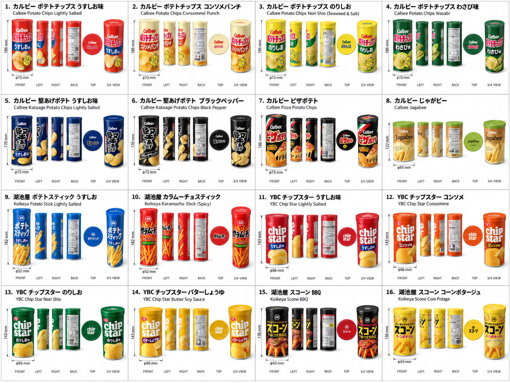
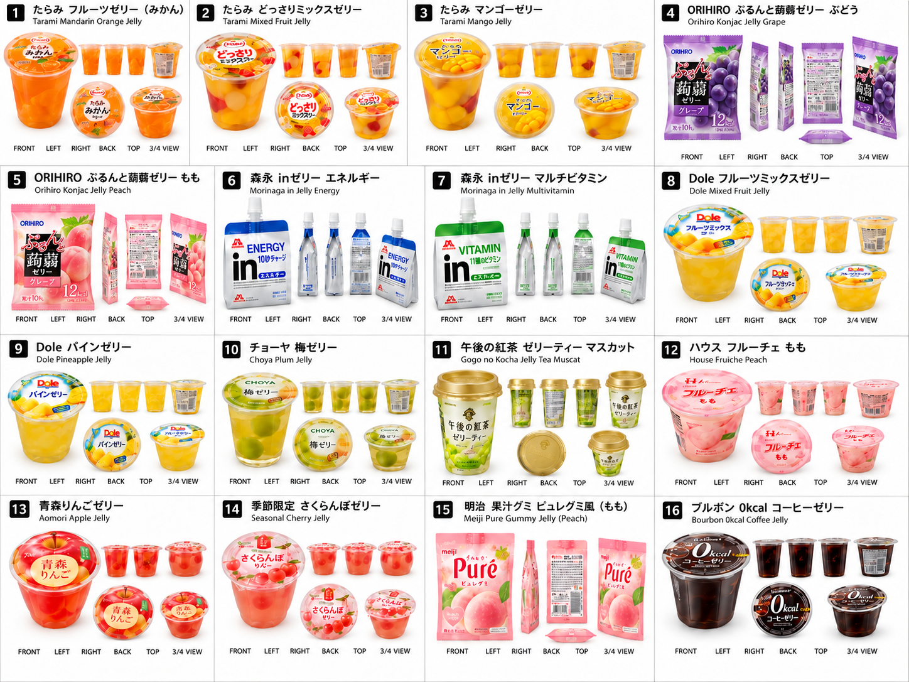
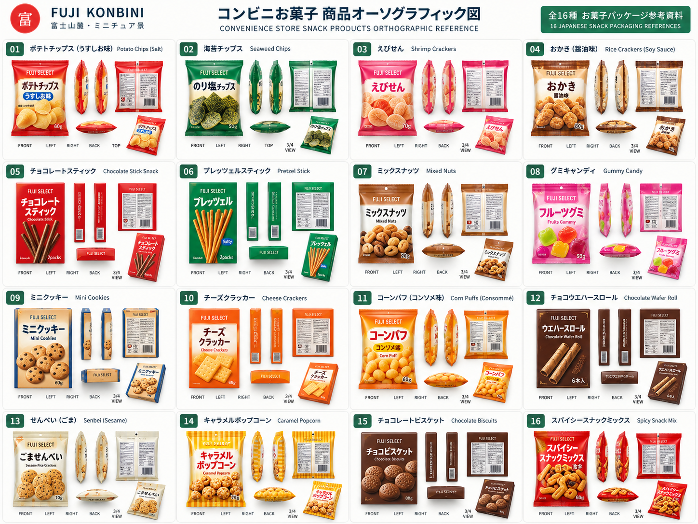
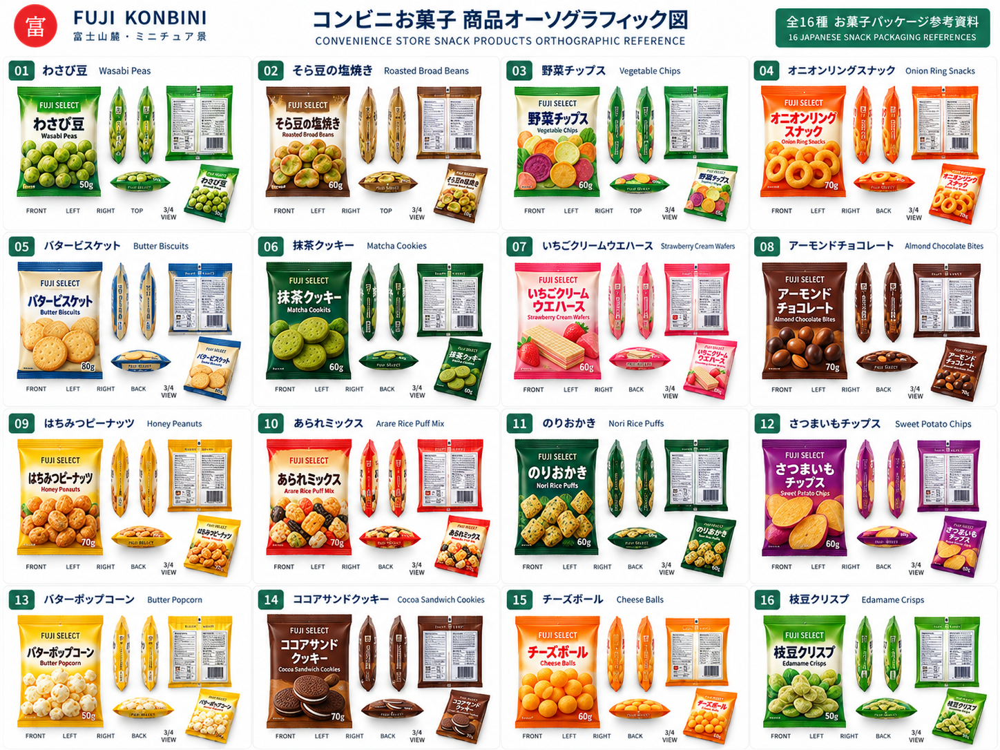

# Snacks · 零食

[← All product references](../README.md)

Original GPT-generated modeling reference sheets supplied by the project owner. View the linked PNG files for full resolution. The number and orientation of views vary by product.

以下为建模时保存的产品正交／多视图参考原图，保持原始文件内容；未裁切成标签，也未重新生成。参考设计与最终店内陈列可能存在差异。

## Chocolate packaging studies

[Original PNG · 1448 × 1086](chocolate.png)

## Candy and mint packaging studies

[Original PNG · 1448 × 1086](candy.png)

## Cans and snack containers

[Original PNG · 1448 × 1086](cans.png)

## Jellies and soft packs

[Original PNG · 1448 × 1086](jelly.png)

## Earlier snack reference — sheet A

[Original PNG · 1448 × 1086](early-products-a.png)

## Earlier snack reference — sheet B

[Original PNG · 1448 × 1086](early-products-b.png)

