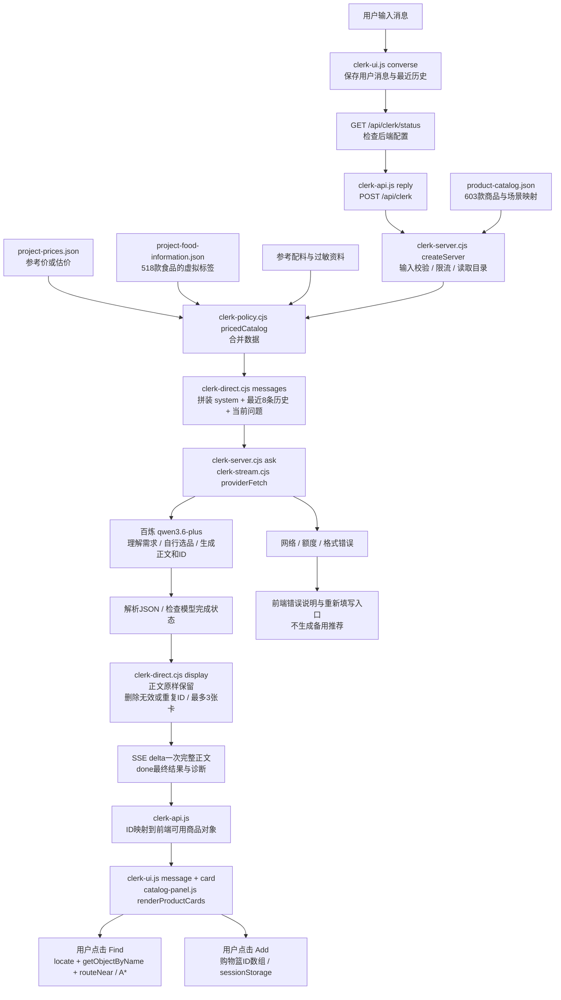

# Fuji Konbini Food Agent 技术架构审查

> GitHub 阅读说明：这是 2026-10-25 本地架构审查的发布副本，正文结论保留，代码链接映射到本仓库的对应模块。原始本地审查文件的 SHA256 见 [来源记录](publication-provenance.json)。原工作工程的 `outputs/fuji-711-diorama/` 对应仓库 `web/`；仅存在本地的启动器和数据生成逻辑以 [摘录](source-context.md) 提供。该审查针对本地工作工程；本仓库运行资源仍为之前上传的快照，后续标签素材未随此次文档更新同步，报告中的本地素材计数不代表仓库素材计数。历史 PID、离线替身结果不代表当前线上服务或真实模型质量验收。


审查日期：2026-10-25（北京时间）；2026-10-13初稿，本次重新核对源文件、配置与离线调用路径
读者：正在学习 AI 产品经理知识的项目作者
范围：当前本地网页及它实际使用的 Node 后端；只读审查，不重构、不修改 Agent，不发送真实模型请求。

> 界面更新（2026-10-25）：按用户要求，店内探索现仅保留第一人称。当前视角、模块引用已同步；下方模型路径、数据和离线实验仍为原审查证据。`audit-evidence.json` 中的源文件哈希是审查时的历史快照，不代表本次界面调整后的全文件一致性；AI对话后端与商品数据未因该调整改变。

## 先理解最重要的结论

**当前代码与配置指定的聊天实现，是“全量商品目录 + 最近聊天历史 → 单次 LLM 直接回答、直接选商品 → 普通代码把 ID 变成卡片”。**

它已经有真实的商品映射、图片、加购、Three.js 定位与寻路。但当前聊天路径没有启用结构化需求记忆、确定性的营养/预算/禁忌筛选、推荐评分与结果事实核验。项目里确实存在这些旧模块，不能因为文件存在就认为现在仍在运行。

2026-10-25复核说明：本地 `http://127.0.0.1:8011/api/clerk/status` 本次无法连接，因此不声称服务当前正在运行或模型当前调用成功。本次没有启动、重启服务。按现有环境和私有配置白名单解析，仍为 `provider=bailian`、`model=qwen3.6-plus`、`replyMode=direct`、`configured=true`、`fallbackModel=null`，与下述代码路径一致。上次证据中的13个关键源文件/数据文件SHA256全部与今天一致。

下面保留的是 **2026-10-13服务在线时** 的历史status证据，其中PID不是今天的运行PID：

```json
{
  "configured": true,
  "provider": "bailian",
  "model": "qwen3.6-plus",
  "runtime": "local-app-backend",
  "pid": 28136,
  "informationScope": "project_virtual_store",
  "replyMode": "direct",
  "fallbackModel": null
}
```

`configured=true` 表示后端找到了密钥，并不表示本次审查成功调用了模型。审查没有消耗模型额度。今天的配置解析与代码路径互相印证；历史status只作为上次运行证据：启动入口把 `config().replyMode === 'direct'` 传给 `createServer()`，`ask()` 首先处理 `directReply` 分支，然后提前返回。

实际工作工程：`D:/codex/2026-09-15/three-js-html-orbitcontrols-2`。网页根目录：该工程的 `outputs/fuji-711-diorama`。本报告保存在建模工作区的 `docs/ai-pm`；GitHub 整理副本不是本次运行源，也没有同步本报告。

## 1. 真实 Agent Architecture Flow

实线表示当前实际调用路径。图中的“选择”在模型内部完成，没有一个可查询分数的后端推荐排序步骤。



下列旧链路**存在但当前未启用**：

```text
LLM 解析需求
→ 结构化 requirements + 服务端 session memory
→ food-evidence / food-control
→ eligibility 商品筛选
→ rank / planOptions 商品与组合排序、预算计算
→ LLM 解释选定结果或代码生成澄清说明
→ validateAnswer / checkedReply
```

代码上关键的分岔：[clerk-server.cjs:108](../../server/clerk-server.cjs)、[clerk-server.cjs:235](../../server/clerk-server.cjs)、[clerk-direct.cjs](../../server/clerk-direct.cjs)。

## 2. 用户发消息后，前端和后端分别做什么

### 2.1 前端

1. 表单提交时，去掉首尾空格。空消息或正在处理上一条消息时不提交；随后清空输入框。
2. `converse(text)` 先复制旧 `history`，再把当前用户消息显示到聊天区并记入历史。因此发送时当前问题不会在历史中重复出现。
3. 暂时禁用发送、情境、餐量、换搭配、语言按钮；显示“正在思考”和秒数。
4. 先调用状态接口，确认后端可达且配置存在，然后调用 `client.reply()`。
5. 请求携带 `message`、`history`、`language`、`sessionId`、简化 UI `state`、`currentProductIds`。
6. 收到结果后，把正文用 `textContent` 放进聊天气泡，将合法 ID 映射成商品对象，渲染卡片。

主代码：[clerk-ui.js:65](../../web/src/clerk-ui.js)、[clerk-api.js](../../web/src/clerk-api.js)。

### 2.2 后端

`createServer()` 处理 `/api/clerk`：检查 Host/Origin、JSON 格式、请求大小和频率；读取当前商品 JSON；合并价格和虚拟食品数据；进入 `ask()` 的 direct 分支。

`normalize()` 限制当前消息不超过 500 个字符；历史最多允许上传 12 条，每条最多 2000 字符，最终取最后 8 条。请求体最多 16000 字节。百炼路径同时最多 1 个请求，所有客户端共享每分钟 20 次的本地限制。

随后 `direct.messages()` 生成当前真正使用的提示词，再通过 `ask()` 与 `providerFetch()` 发出 HTTPS 请求。

当前实际模型接口：

```text
https://dashscope.aliyuncs.com/compatible-mode/v1/chat/completions
model: qwen3.6-plus
response_format: { type: "json_object" }
max_tokens: 1024
enable_thinking: false
stream: false（当前 direct 的上游请求）
```

这里的 JSON mode 帮助模型返回 JSON，并不等于严格保证商品选择、营养数值或金额正确。当前 request payload 没有 `tools`，没有 LLM 工具调用。

### 2.3 谁负责什么

| 工作 | 当前负责人 | 确定性边界 |
|---|---|---|
| 理解“减脂、预算、想吃饱、不要炸物” | LLM | 没有结构化解析结果供代码复核 |
| 理解追问、保留或更改条件 | LLM 读取历史 | 没有持久需求字段 |
| 选商品、组合商品 | LLM | 后端不计算排名 |
| 在正文计算总价、热量、蛋白质 | LLM | 当前没有计算器或数值核验 |
| 读取目录、合并价格和食品数据 | 普通 Node 代码 | 可追踪到本地 JSON |
| 删除未知 ID、去重、限制3卡 | 普通 Node 代码 | 不修改正文里的相应错误 |
| 显示图片和名称 | 普通前端代码 | 取商品目录里的既有素材 |
| Find、寻路、加购、移除 | 普通前端代码 | 用户点击才执行 |
| 网络超时、额度错误、格式错误提示 | 普通代码 | 当前不生成本地备用搭配 |

### 2.4 回答怎么到页面

浏览器请求 SSE，后端会先发 `status` 和每 10 秒一次等待心跳。但是当前 direct 路径中的递归 `ask()` 不传 `onText` 给上游，而且 `requestMessages` 分支强制 `stream=false`。因此**模型并没有逐字流式返回给页面**。

模型完整 JSON 到达后，`display()` 处理 ID；外层再发一次包含完整正文的 `delta`，最后发 `done`。前端收到 `done` 后移除临时气泡，用最终回答重新渲染并记入历史。

“页面使用 SSE”与“模型逐字流式生成”是两回事。当前 SSE 主要承担等待心跳和结果运输。

## 3. Context / Memory：当前怎么记住你

### 3.1 各种信息实际存在哪里

| 信息 | 保存位置 | 刷新后的情况 | 是否进入当前 LLM 提示词 |
|---|---|---|---|
| 聊天历史 | `clerk-ui.js` 闭包中的 `const history=[]` | 清空 | 最近8条会发送 |
| 屏幕上聊天气泡 | DOM，最多30个元素 | 清空 | DOM本身不会发送 |
| UI情境、餐量、exclude、paused | 前端 `state` 对象 | 重新初始化 | 请求携带，但 direct.messages 没有使用 |
| 当前推荐 ID | 前端 `selected / aiProducts` | 初始化为本地情境搭配 | 请求携带，但 direct.messages 没有使用 |
| `sessionId` | 前端变量；direct返回固定字符串 `direct` | 清空 | 没有对应服务端独立记忆 |
| 购物篮 | 前端数组 + `sessionStorage['fuji-basket-v22']` | 同标签页刷新通常恢复 | 当前不发送给模型 |
| 行走视角 | 由导航相机提供第一人称视角 | 无需保存视角偏好 | 不发送 |
| 旧版需求记忆 | 后端 `sessions Map` | 服务重启丢失；旧模式30分钟不活动过期 | 当前 direct 路径不创建/读取/更新 |

聊天记录既没有数据库持久化，也没有存入 sessionStorage。购物篮能恢复，并不代表聊天偏好也能恢复。模型 API 请求也没有接入一个持久会话对象；每次重新组装 `messages`。

### 3.2 提示词的真实顺序

普通当前模型使用的顺序是：

```text
1. system：虚拟便利店助手身份、当前语言、JSON输出要求、全部603条目录
2. history[0]：旧的user或assistant消息
3. history[1] ... history最后一条：最多8条
4. user：当前问题原文
```

`ask()` 还会在第一个 system 消息末尾补一句 `Return a valid JSON object.`。旧 `payloadFor()` 里很长的温柔店员、过敏、价格保护等指令会被构造，但 direct 的 `requestMessages` 覆盖了最终 `payload.messages`；不能把旧模板里的规则算到当前提示词中。

真正的 system 主要要求：虚拟门店、自然回答、可讨论所有部门、自行选商品、不暴露内部 ID、JSON `{message,productIds}`、目录信息是项目虚拟标签。没有明确的减脂计算标准、预算核算步骤、连续需求状态合同或完整的防幻觉要求。

### 3.3 连续说“我要减脂”→“预算500日元”→“不要鸡肉”

当前第三次请求会携带前两次用户消息及成功的助手回复。模型要自己从这些文字中读出“减脂 + 500日元 + 不要鸡肉”。没有如下已确认对象被持久保存：

```json
{
  "goals": ["fat_loss"],
  "budget": {"amount": 500, "currency": "JPY"},
  "avoid": ["chicken"]
}
```

上面的对象只是解释“结构化状态是什么”，不是当前 direct 运行时产物。项目的 `food-agent.blankMemory()/parsePlan()` 旧路径曾支持类似字段，现在被绕过。

如果接着说“不要鸡肉改成不要牛肉”，当前只能依赖模型理解是替换还是追加。代码没有替换规则、条件来源记录或明确的 `corrections` 更新。

### 3.4 截断、覆盖、遗忘风险

- `message()` 每次只保留最近8条**消息**，不是8轮对话。正常一问一答大致相当于4轮；下一次提交使用提交前的8条历史，再额外加当前问题。更早的“减脂”或“过敏”会被删除，没有摘要补回。
- 页面可以仍显示更早气泡（最多30个），但模型已经看不到它们。用户会误以为“你明明还看得到，为什么忘了”。
- 初始化欢迎语也会进入历史，占一个消息位置。
- 请求失败后，用户消息仍记入历史；失败提示用 `remember=false` 不记入。连续失败会挤掉以前的偏好，下一次模型也不知道之前哪次请求失败。
- 前端没截断长助手正文，后端却拒绝历史中超过2000字符的消息。一个长回答可能让下一次请求报 `invalid_history`；这只是代码边界分析，不是声称本轮发生过。
- 16000字节请求上限与逐条2000字符上限是不同限制：多条中文长消息可能在未触发单条限制前先超过总字节限制。
- 没有按 token 预算压缩全量目录或聊天历史。不存在应用主动做的语义摘要，也没有证据表明当前模型会自动替你保留丢掉的历史。
- direct回复会把 `context/size` 原样取自UI、`dietaryCaution=false`；正文理解了“吃饱”也不会把 UI 餐量自动更新成 full。直接输入的条件与UI显示可能不一致。

## 4. 商品数据怎样参与推荐

### 4.1 数据文件与字段

这里的“数据库”主要是本地 JSON 文件，不是 SQL 数据库或向量数据库。

| 文件 | 内容 | 当前实际用途 |
|---|---|---|
| `data/product-catalog.json` | 603条商品，19个区域 | 商品身份、前端图卡与3D映射；后端选品目录 |
| `data/project-prices.json` | 603条项目价格和依据 | 合并为 `projectPriceJPY` 后发给模型；前端显示参考/估价 |
| `data/project-food-information.json` | 603条记录，其中518条 `food=true` | 合并为 `projectFoodInfo`；当前发出其部分字段 |
| `data/product-ingredients.json` | 同类配料参考等 | `pricedCatalog`加载；当前direct精简目录没有发送这套独立参考对象 |
| `data/product-allergens.json`（clerk-allergens.load读取的文件） | 同类过敏参考 | 合并为 `allergenInfo`；direct不运行旧过敏核验 |
| `data/food-facts.json` | 旧 Food Agent 派生快照 | 当前 direct 不读取该快照；改它不会直接改变当前推荐 |

商品目录主要字段：

- 身份：`id`、`zh/en/ja`、`zone`、`kind`、`nameStatus`、`translationStatus`。
- 场景：`node`、`anchor`、`center`、`stand`、`layer`、`displayUnits`、`sourceAsset`。
- 图片：`image`、`imageKind`、`imageWidth/Height`、`imageBackground`、`imageSource`。
- 早期推荐标签：`role`、`tags`、`occasions`、`featured`。
- 原基础字段：`price/ingredients/allergens/nutrition`。它们与合并后的 `projectPriceJPY/projectFoodInfo` 不是同一层；基础字段为空不代表当前模型完全拿不到数值。

本次数据统计：603条目录；518条虚拟食品记录、85条非食品；603条价格中118条为官方同类价格参考、485条为类别估价。419条已有用户提供的商品标签图。商品图片、项目食品数值和真实包装核实是三个独立概念；补漂亮图片不会自动补营养数据。

### 4.2 calories、protein 是否真正用了

**会进入当前模型输入，但没有被当前代码用于筛选或数值核验。**

`clerk-direct.messages()` 发给模型的每行是：

```text
[ID, 中文名, 英文名, 日文名, 区域, 项目日元价, 可选食品信息]

食品信息 = [
  [份量, g或ml],
  [kcal, protein_g, fat_g, carbs_g, sugar_g, salt_g, sodium_mg, caffeine_mg],
  项目配料,
  contains,
  crossContact,
  保存温度,
  加热服务
]
```

当前518条食品的上述营养字段均有值，无null；这说明虚拟数据覆盖完整，不说明真实测量完整。非食品的食品信息为null。

这些数值来自用户授权的项目虚拟标签设计与同类资料。文件明确记录 `physicalPackageVerified=false`、`nutritionBasis=project_per_serving_design...not physical package measurements`。生成脚本会按食物类型套用份量、蛋白质、脂肪、碳水等数值，并按 `蛋白质×4 + 脂肪×9 + 碳水×4` 推导热量；它们不是逐款读取真实包装后得到的测量。

如果你编辑的是 `project-food-information.json` 相应条目，这些字段会在下一次请求重新加载。若只改商品标签图、旧 `food-facts.json` 或基础 `product-catalog.json.nutrition`，不能认为当前 direct 已使用新数字，因为它读取的是 `projectFoodInfo.nutrition`。

### 4.3 “低热量、高蛋白、饱腹感强”当前怎么判断

目前系统没有在代码里设定“低热量小于多少”“高蛋白大于多少”“饱腹权重多少”。模型看名称、价格和输入的营养数字后自行判断，可能比较，也可能凭一般印象；**代码审查无法证明每次输出都实际比较了所有商品数值**。

当前不会：

```text
只保留非炸物 → 总价≤500 → 蛋白质达标 → 计算饱腹分 → 排名取前3
```

它实际是：

```text
完整目录给模型 → 模型内部自行选品 → 代码只映射选中的ID
```

### 4.4 satiety 确实存在，但当前没有用上

`project-food-information.json` 中存在 `satiety`，518条食品都有值。生成规则是：

| 由宏量营养素推导的热量 | satiety |
|---|---|
| ≥500 kcal | `full_meal` |
| ≥180、<500 kcal | `light_meal` |
| <180 kcal | `light_snack` |

这只是用热量给项目划“正餐/轻食/零嘴”标签，**不是根据蛋白质、纤维、体积等验证的生理饱腹模型**。例如项目巧克力217 kcal会被标成light_meal，不能据此保证它适合“减脂又吃饱”。

当前 direct 精简行没有 `satiety`；同样省略了 `preparation`、`readyToEat`、`dietary`、`stock`、`servingTemperatures`、`taste`、完整来源与价格依据类别。因此系统拥有这些数据，不等于当前模型能看到它们。特别是“不要炸物”缺少显式 `preparation` 字段，模型只能更多依赖商品名、分类和一般知识推断。

旧 `food-agent.facts()` 会带上satiety，但旧 `rank()` 也没有把satiety作为评分项。不能说项目已经实现“饱腹感排序”。

### 4.5 有没有真正的 Recommendation Ranking

**当前路径没有。** 没有代码评分、可解释排名、学习型推荐模型、向量检索或 reranker。当前JSON商品数组按既有目录顺序送入模型；输出数组顺序由模型决定，代码只去重取前三。

旧代码确实有 `rank()` 与 `planOptions()`：例如高蛋白目标加 `protein_g/2`，减脂/低热量减 `kcal/60`，近期推荐扣5分，部分烹饪方式加2分；每个餐位排序取前8、组合算总价再按分数排序，最后保留最高方案。但这属于未启用的结构化路径，不能用它解释当前页面回答。

## 5. 准确性、Grounding、Hallucination Control 与 Fallback

### 5.1 已有的准确性基础

1. 模型能看到本店完整商品目录和项目数值，有可依靠的数据。
2. 后端只让目录中存在的ID进入返回卡片；去掉重复ID，最多3个。
3. 前端再次验证ID属于当前加载且场景可用的商品；无法映射时请求整体失败。
4. 卡片名称、图片、Find目标都由目录生成，不直接照模型编造的商品对象。
5. JSON解析、模型完成状态、鉴权、HTTP/网络错误、超时等仍有技术检查。
6. 正文用 `textContent` 显示，模型生成HTML不会直接作为HTML执行。

这些保护主要保证“页面能安全显示并映射商品”，不保证“推荐符合所有需求且解释正确”。

### 5.2 当前没有的业务保护

direct路径不会运行 `eligibility()`、`validateAnswer()`、`checkedReply()` 的语义保护，当前没有确定性的：预算合计、营养合计、数值来源核验、过敏冲突检查、炸物排除、正文与卡片名称一致性检查、减脂效果保证拦截。

后端会原样保留模型正文。如果模型说一个目录外商品名、错写蛋白质或金额、把“建议加入”写成“已经加入”，当前这些句子可能照常显示。

### 5.3 错误商品 ID 的实际结果

例如模型返回：

```json
{
  "message": "这里是模型写的原始正文",
  "productIds": ["oden:egg", "不存在的ID", "oden:egg"]
}
```

后端会得到一张 `oden:egg` 卡片，错误和重复ID被静默删除；`modelProductIds`仍保存原始数组；正文不改。如果全部ID都不存在，就没有卡片，正文仍可能保留。未知ID在当前模式通常**不是**旧模式那种 `unknown_product` 整体拒绝。

如果ID后端有但前端对应3D节点不可用，客户端 `byId` 排除它，随后 `invalid_response`；UI清空推荐并显示失败。这是后端目录合法性与前端场景可用性的两层检查。

`display()` 对正文只检查它是不是字符串，空字符串也没有明确拒绝；`productIds`非数组时当空数组。当前不是完整的严格响应Schema验证。

### 5.4 缺失营养数据怎么办

当前518条虚拟食品数值覆盖完整。但若未来条目没有 `projectFoodInfo`，会传null；内部缺字段在JSON数组里也可能变为null。当前没有自动检查“不能满足营养判断”的分支、强制澄清或数据不足决策。是否承认未知由模型决定，代码不强制。

旧 C2 的数据不足/冲突决策模块存在，但 direct不会调用。不能把旧代码的严格未知处理算作当前能力。

### 5.5 Fallback 的精确含义

- 请求失败后，`converse()` 不调用本地 `E.reply()`；显示原因、诊断与重新填写入口，清空推荐。没有备用商品，没有自动不停重试。
- 首次进入页面、未配置模型时的情境按钮等仍能通过 `E.choose()` 显示本地固定搭配；它不是聊天请求失败后的备用AI回答。
- 当前 `fallbackModel=null`。虽然 `askWithModelFallback()` 保留了特定旧character模型额度耗尽时切换到另一character版本的代码，但当前qwen3.6-plus不会满足那个条件，没有当前自动模型降级链。

### 5.6 数据本身也需要审查

本次只读检查发现项目数值与属性生成存在值得注意的例子：

- `fried:karaage`（日式炸鸡）的虚拟记录 `dietary.vegetarian=true`。生成规则通过英语名字/配料关键词判动物成分，但“Karaage”和“主料”没有匹配chicken或肉类词，导致错误属性。当前direct没发dietary，所以该字段不会作为当前显式素食依据，但若以后启用旧筛选或扩充提示词，会直接影响正确性。
- `snacks:NEW_01`（明治牛奶巧克力）的虚拟咖啡因值为45mg。生成器按 `/cola/` 分支赋45，而 `chocolate`含有这个子串，会命中汽水规则；该值已经被发给当前模型。这里错误来自数据生成，不一定是LLM编造。
- satiety仅按热量阈值分档，不能把它宣传成可靠饱腹评估。

本次没有修正这些数据，只记录其真实实现和影响。数字能追溯到项目文件，与数字来自准确真实包装，是两种不同的“可信”。

## 6. 推荐怎样与 3D 店铺、Find 和购物篮互动

### 6.1 同一个商品ID贯通三层

```text
模型返回ID
→ clerk-api.js 按ID得到目录商品对象
→ catalog-panel.js 按对象渲染名称/图片/按钮
→ Find使用对象.node、center、stand
```

`loadProductCatalog(world)` 读取目录，利用 `THREE.PropertyBinding.sanitizeNodeName()` 规范节点名，遍历 `world.root` 的实际节点；不存在的商品标为 `unavailable`。这一步不是让模型看截图寻找物品。

### 6.2 Find是普通前端函数，不是LLM Tool Calling

`productRow()` 给按钮绑定 `onLocate(p)`；推荐卡、Browse和底部Find都使用 `clerk-ui.locate(p)`。

执行步骤：

1. `world.root.getObjectByName(p.node)` 找到对应Three.js对象；找不到就提示无法定位。
2. 优先用目录 `center` 作为目标；否则用对象世界坐标。
3. 显示一个Three.js环形/箭头标记。
4. 必要时进入步行模式；以目录 `stand` 作为货架前站立位置。
5. `nav.routeNear()` 在附近0.2m网格上找可站点；尝试距离最近的最多20点。
6. `routeTo()` 用A*搜索四方向路径，避开碰撞；逐帧更新位置，到达后朝向商品。
7. 用户按WASD可以取消引导。第一人称行走与渲染使用同一个 `navigation.camera / ctx.camera`；`store-clerk.js` 仅处理收银台店员与靠近交谈入口，不接管相机。

Find无需后端请求或额外模型token。即使LLM在正文说“我带你去”，真正移动仍须触发现有前端操作；当前正文没有这类虚假执行宣称的强制校验。

### 6.3 购物篮

单品 Add 调用 `addProduct(p)`，向 `basket` 推入商品ID；重复ID代表数量。`basketRender()` 分组显示数量、绑定Remove并保存sessionStorage。最多30件。整组 Add pairing 一次加入当前推荐的全部ID。

推荐、Find和加购是独立动作：推荐不会自动加购，Find不会自动加购。购物篮不会回传到当前模型。因此“我购物篮里的东西”如果未在聊天中说明，模型并不能读取实际购物篮；旧聊天中说“加了”也不能证明它真的进入购物篮。导出的receipt是虚拟清单，没有支付或真实下单。

## 7. 用你的具体例子追踪完整流程

用户：**“我在减脂，预算500日元，想吃饱一点，不要炸物。”**

以下是基于当前代码的执行追踪，不是声称本次实际请求了LLM并得到某个推荐。本次用离线fetch替身检查了实际请求构造与结果处理；真实模型调用数为0。

### 7.1 输入和上下文

`onsubmit → converse()` 收到原文。先取旧8条历史，显示并记录这条消息。

UI会上传例如：

```json
{
  "message": "我在减脂，预算500日元，想吃饱一点，不要炸物。",
  "history": [],
  "language": "auto",
  "sessionId": "direct",
  "state": {"context":"afternoon","size":"light","exclude":[],"paused":false},
  "currentProductIds": ["bakery:MELON_PAN","coffee:cafe-latte"]
}
```

这是离线构造的可复现输入，不是读取或伪造用户当前聊天内容。

### 7.2 需求理解

`normalize()` 检查长度与类型，不把句子解析成减脂/500/饱腹/非炸物字段。`direct.messages()` 根据汉字选择中文，把完整问题放在最后一个user消息。

模型在一次生成里同时负责需求理解、条件联系、商品选择和解释；不存在单独可检查的 `plan`。

### 7.3 商品检索

后端读取603条商品，合并全部价格与518条食品信息。没有先检索“减脂相关商品”，没有倒排/向量查询，也没有候选池缩小过程。整个目录放入system。

例如实际发送的鸡蛋数据包含项目价、60g份量、77kcal、6.7g蛋白质、4.9g脂肪、1.4g碳水等。白萝卜记录有16kcal、1g蛋白质、100g份量。是否选择这些商品是模型决定，不能从“数据存在”推出它们一定会被推荐。

### 7.4 筛选和排序

**此步在当前普通代码中不存在。** `noFried`、预算500、减脂目标不进入 `eligibility/rank/planOptions`。甚至显式preparation与satiety没有出现在当前精简目录里。

模型可能依赖名字/分类排除炸物，比较数值、组合商品并估计饱腹；这些都是模型的自由判断。这里不能画一个“数据库确定性筛选与排序”框来美化实际系统。

### 7.5 LLM调用

`ask → providerFetch → 百炼qwen3.6-plus`。离线捕获的请求证明只有system+user（空历史时），JSON mode，输出上限1024，`stream=false`，没有tools。当前603条目录生成的system正文为 **98,436字符 / 117,430 UTF-8字节**，尚未算历史和其它JSON传输字段；这是字符/字节量，不冒充精确token计数。

### 7.6 结果处理

假设模型返回JSON，代码先检查响应是否完成且可解析，然后 `display()`：

```text
message 原样保留
productIds 删除无效ID/重复ID，截为最多3个
context/size 取原UI值
dietaryCaution=false
sessionId='direct'
```

本次离线替身故意返回一句包含“未核验数字9999千卡”的正文与 `[oden:egg, 不存在ID, oden:egg]`。结果正文原样通过，卡片只剩鸡蛋。这不是模型实际胡说，而是用构造输出验证当前代码保护边界：**ID映射保护成立，营养事实核验并未执行。**

### 7.7 到页面和Find

后端发一次完整正文delta和done；前端按合法ID查商品对象，显示其现有名称、图片、Add和Find。

如果返回的卡片包含 `oden:egg`，点击Find按目录找到 `ODEN_V13_simmered_egg`，使用对应center与stand、A*寻路并显示标记。这个交互路径是确定性的；是否满足“500日元以内且减脂吃饱”不由Find证明。

## 8. 模块、代码文件与核心函数

下表链接指向实际D盘运行源。

| 模块 | 文件与核心函数 | 当前作用/状态 |
|---|---|---|
| 启动 | [start-preview.ps1](source-context.md#local-preview-launcher) | 隐藏启动Node、本地8011；服务未运行时恢复 |
| 场景装配 | [app.js:223](../../web/app.js) | 加载目录、收银台店员、店员UI |
| 前端聊天与操作 | [clerk-ui.js](../../web/src/clerk-ui.js)：`installClerkUI/message/converse/card/locate/addProduct/basketRender` | 当前启用 |
| 前端API | [clerk-api.js](../../web/src/clerk-api.js)：`createClient/status/reply/diagnosticText` | 同源请求、SSE解析、ID映射与错误提示 |
| 图卡/Browse | [catalog-panel.js](../../web/src/catalog-panel.js)：`artwork/productRow/renderProductCards/enhanceClerkCatalog` | 图片、名称、分页、文本搜索与分类过滤 |
| 目录及场景校验 | [product-catalog.js](../../web/src/product-catalog.js)：`loadProductCatalog` | 前端读取目录与价格、节点校验、标unavailable |
| 初始固定搭配 | [clerk-engine.js](../../web/src/clerk-engine.js)：`configure/createState/choose` | 初始化与未连接情境搭配；不是当前LLM选品逻辑 |
| 私有HTTP/LLM后端 | [clerk-server.cjs](../../server/clerk-server.cjs)：`config/resolveConfig/normalize/createServer/ask/parseModelReply/askWithModelFallback` | 当前主路由、配置、技术校验、模型HTTP与SSE |
| 当前直接回答 | [clerk-direct.cjs](../../server/clerk-direct.cjs)：`messages/display` | 当前实际system与商品行、原正文保留、最多3卡 |
| 目录合并 | [clerk-policy.cjs:7](../../server/clerk-policy.cjs)：`pricedCatalog` | 当前会调用此合并函数；不代表整个policy编排启用 |
| 网络适配 | [clerk-stream.cjs](../../server/clerk-stream.cjs)：`providerFetch/consumeZhipu` | 原生HTTPS、可选本地CONNECT代理、AbortSignal；上游流式消费函数当前direct不走 |
| 3D寻路 | [navigation.js](../../web/src/navigation.js)：`routeNear/routeTo/blocked/move/update` | 0.2m网格A*、碰撞、逐帧行走 |
| 收银台店员 | [store-clerk.js](../../web/src/store-clerk.js)：`makeStoreClerk/installStoreClerk/update` | 保留店员与靠近交谈；第一人称相机由navigation管理 |
| 虚拟食品标签生成 | [build-food-information-v57.cjs](source-context.md#virtual-food-data-generator) | 离线生成数据；每次用户聊天不会运行 |
| 旧结构化Food Agent | [food-agent.cjs](../../server/food-agent.cjs)：`blankMemory/facts/parsePlan/eligibility/rank/planOptions/orchestrate/validateAnswer` | 文件存在，当前聊天绕过 |
| 旧状态/证据/决策 | [food-information.cjs](../../server/food-information.cjs)、[food-evidence.cjs](../../server/food-evidence.cjs)、[food-control.cjs](../../server/food-control.cjs)、[food-decision-reply.cjs](../../server/food-decision-reply.cjs) | 当前绕过，不提供当前需求记忆/冲突检查 |
| 旧精简模式 | [food-slim.cjs](../../server/food-slim.cjs)：`orchestrate/update/guard` | 当前绕过；slim与direct不是同一模式 |
| 旧价格/过敏/可售咨询 | `clerk-prices.cjs / clerk-allergens.cjs / clerk-availability.cjs / clerk-conversation.cjs` | 旧路由仍保留，但当前direct提前返回；不能称当前金额查询0模型调用 |

补充：`rank`是food-agent文件内部函数，没有导出给当前direct使用。服务端有旧业务 `server/skills/food-selection/SKILL.md`，但当前direct也没有读入该Skill。它不是自动安装到模型里的知识。

## 9. 已实现、部分实现、尚未实现/当前未启用

| 功能 | 当前分类 | 解释 |
|---|---|---|
| 与真实LLM连接并自然语言回答 | 已实现 | 百炼qwen3.6-plus；本次仅验证配置和调用代码，不做质量复测 |
| 603目录注入与518虚拟食品数值输入 | 已实现 | 每次全量读入，精简数组注入system |
| 中日英自动/手动语言 | 已实现 | 当前direct Auto用假名/汉字规则，否则英语；不是完整任意语言检测 |
| 商品ID卡片、独立加购、购物篮、Find | 已实现 | 普通前端映射和操作 |
| 最近聊天上下文 | 部分实现 | 8条消息，刷新丢失，无摘要 |
| 预算、营养、禁忌遵守 | 部分实现 | 模型可以读条件和数字，但当前代码不强制核验 |
| Grounding | 部分实现 | 有目录依据和ID映射；正文不核验 |
| 流式体验 | 部分实现 | SSE等待心跳与最终正文；上游direct不逐字流 |
| 饱腹数据 | 部分实现 | 热量分档字段存在；当前不发送、不排名 |
| 结构化Conversation State | 当前未启用 | 旧requirements/session Map代码存在；direct不走 |
| 代码检索、筛选与Recommendation Ranking | 当前未启用 | 旧eligibility/rank/planOptions存在 |
| 过敏、预算、营养、正文一致性的业务Guard | 当前未启用 | 旧保护存在，但direct绕过 |
| 长期个人记忆/用户账号画像 | 尚未实现 | 无当前用户记忆数据库 |
| RAG向量检索/embedding/reranker | 尚未实现 | 当前不是检索增强链路；Browse文本搜索也不是RAG |
| LLM Tool Calling执行Find/购物篮 | 尚未实现 | 无tools定义；用户点击前端操作 |
| 当前请求失败的备用推荐 | 未实现且按用户要求不启用 | 失败只说明原因，不生成另一套商品 |
| 精确真实商品营养与过敏认证 | 尚未实现 | 当前是虚拟项目设计，不是实物包装全面核实 |
| 个性化训练/微调/在线学习 | 尚未实现 | 补目录和提示词不等于训练模型 |

## 10. 最值得关注的五个问题

### 1）历史窗口短，没有可靠的条件记忆

为什么影响体验：用户连续聊几轮后，预算或排除项可能从模型输入中消失，但旧聊天还在页面可见。用户会感到店员“不听话”或“忘记我的过敏”。

代码依据：前端history限制8条；direct无requirements记忆；当前固定sessionId不对应后端会话。它是上下文设计问题，不一定通过换更强模型解决。

### 2）模型同时理解、选品、算数、解释，结果缺乏业务核验

为什么影响体验：有真实商品卡不代表搭配在预算内、符合不要炸物或营养目标。错误价格/数值/内部ID仍可能在正文出现；删除错误卡片又不修改正文会制造“文字推荐A，卡片显示B”的不一致。

代码依据：direct.display只管字符串与卡片ID；rawReply绕过checkedReply与旧food Guard；离线构造输出证明未核验数字原样通过。

### 3）关键产品信息在当前提示词中缺失

为什么影响体验：已经存好的satiety/preparation/readyToEat等没有发给当前模型，“想吃饱、不要炸物”只能凭名字与常识猜。UIstate、当前卡片、购物篮也没有进入模型，有“换这个、保留那一款”或“篮子里已有”的追问会更模糊。

代码依据：clerk-direct.messages的字段数组；它没有读取input.state/currentProductIds；basket不在请求体。问题是信息传递，而不是数据库完全没数据。

### 4）虚拟标签的数据质量与来源层次容易混淆

为什么影响体验：模拟数字可以让产品演示更完整，却不能自动当真实营养。巧克力咖啡因子串误判、炸鸡素食标记、用热量代替饱腹标签，都可能成为回答或未来筛选的错误依据。价格的official_analog/category_estimate虽然前端区分，但当前模型行只见一个价格数字与泛化项目价说明。

代码依据：v57生成器、具体JSON条目、pricedCatalog与direct字段压缩。需要把“模型没编造”与“来源数据正确”分别评估。

### 5）每次全量大目录、输出空间短、等待期间无真正模型流

为什么影响体验：每次输入约98,436字符的system，即使问一句简单问题，也重复传全部603条数据。增加延迟、成本/额度压力和关注信息负担；1024输出token上限还可能导致JSON未完成或解释过长后被截断。页面等待计时不等于逐字回复，用户容易认为卡住。

代码依据：direct.messages全量catalog；requestMessages设置max_tokens1024、stream=false；finish_reason非stop判incomplete_response；90秒后端/105秒前端超时。具体成本与真实延迟需要另行实测，本次不根据字符数编造token账单。

## 11. 把主要AI概念讲简单

| 概念 | 简单解释 | 在本项目里的对应 |
|---|---|---|
| LLM | 一个擅长理解和生成文字的模型 | 当前qwen3.6-plus读目录并生成回答 |
| System Prompt | 这次对话给模型的角色和规则说明 | direct.messages里的system文本；不是训练 |
| Context | 模型这次能看到的全部材料 | system+全目录+最近8条历史+当前问题 |
| Memory | 下一次还能找回的重要信息 | 当前只有短历史；没有可靠长期条件记忆 |
| Conversation State | 把“500日元、不要鸡肉”等写成明确字段 | 旧Food Agent有，当前direct没用 |
| Grounding | 让回答依据提供的资料而不是随口编 | 有目录和虚拟数值输入，但正文核验不足 |
| Hallucination | 说出没有依据或与资料不符的内容 | 可能是错数值、错商品名、虚假已加购 |
| Guardrail | 普通代码设置的检查和拒绝规则 | 当前技术/ID检查有效，业务规则绕过 |
| JSON mode | 让模型按机器更容易解析的格式输出 | 当前要求message与productIds；不保证业务正确 |
| Retrieval | 先从大库里找出本次最相关的小部分资料 | 当前聊天没有这个步骤；全量塞目录 |
| RAG | 先取资料，再让模型依据资料回答 | 当前有资料注入，但没有独立检索步骤，不能称已实现向量RAG |
| Ranking | 给候选打分并决定谁排前面 | 旧rank有规则分数，当前直接让模型选 |
| Tool Calling | 模型请求调用一个明确工具，程序执行并把结果回给模型 | 当前没有；Find是按钮点击函数 |
| SSE / Streaming | 从服务器持续发消息，让页面能不断更新 | 当前有等待心跳，模型最终文本一次发回 |
| Fallback | 主方案失败时换一条可用路线 | 当前失败提示，不生成备用搭配或自动换当前模型 |
| Fine-tuning / Training | 用训练数据改变模型参数 | 本项目没有；改提示词/数据只是给模型更多材料 |

作为AI产品经理，你可以先把系统拆成“它看到什么 → 谁做决定 → 谁复核 → 如何执行 → 什么会被记住”。本项目现在强在场景互动和商品映射，弱在需求持续记忆、选品可控性和事实核验；这与是否拥有一个能说自然话的LLM是不同的能力。

## 12. 本次审查证据与边界

- 2026-10-25只读核对实际D盘代码/JSON与配置。配置通过生产解析函数解析，输出严格限定为provider/model/mode等白名单，没有展示、复制或保存真实密钥；本地status无法连接，未启动服务。
- 对当前生产函数 `normalize/pricedCatalog/direct.messages/ask/direct.display` 使用离线fetch替身，实际模型请求0次。替身只检查请求组装与映射边界，不证明真实模型推荐质量。
- [audit-evidence.json](./audit-evidence.json) 保存运行状态、数据统计、提示词字符/字节量、离线构造输入/输出、观察到的payload参数以及关键源文件SHA256。
- 架构图来自实际函数路径；本次没有在浏览器发送示例问题，也没有宣称已得到示例的真实模型推荐。
- 没有修改启动配置、Agent代码、提示词、商品数据、模型或网页样式，没有推送GitHub。仅新增本报告及审查证据文件。
- 此结论针对2026-10-25核实的direct代码与配置。上次13个关键文件哈希未变化；本次重新执行离线请求构造/错误ID去重/原文保留检查，通过。真实模型调用0次，不等于在线质量验收。若以后切回structured/slim，必须重新核对启用分支。
- 独立流程图源文件：[architecture-flow.mmd](./architecture-flow.mmd)。本仓库提供复核后的主报告与audit-evidence.json；历史初稿保留在原本地工作区。
